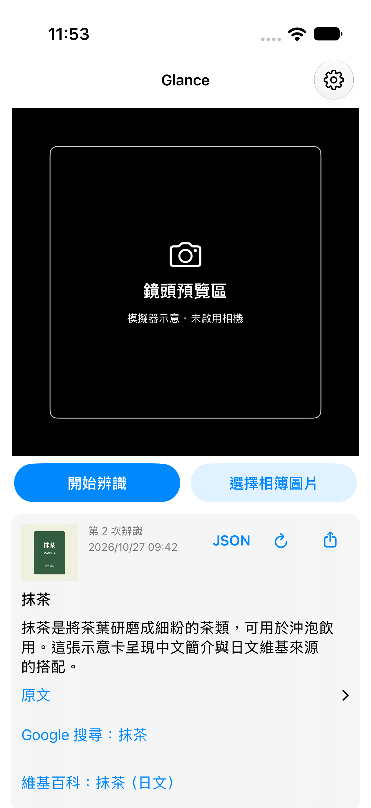
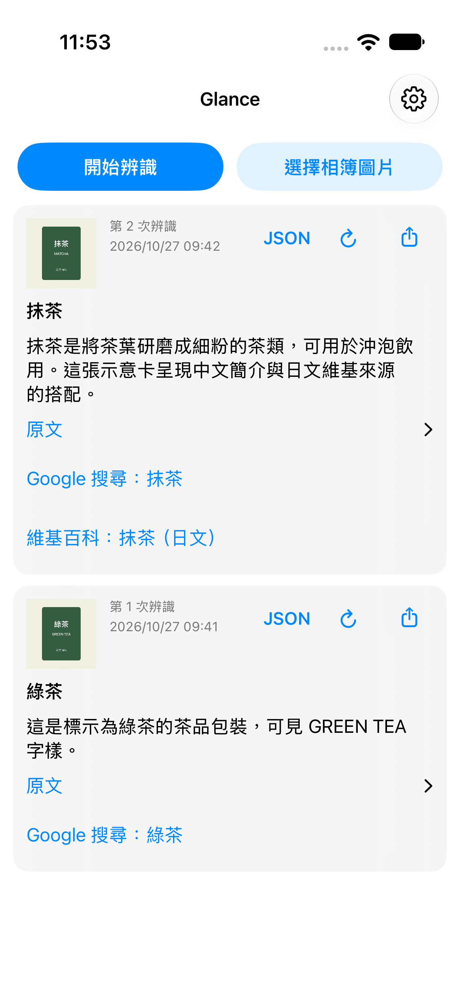
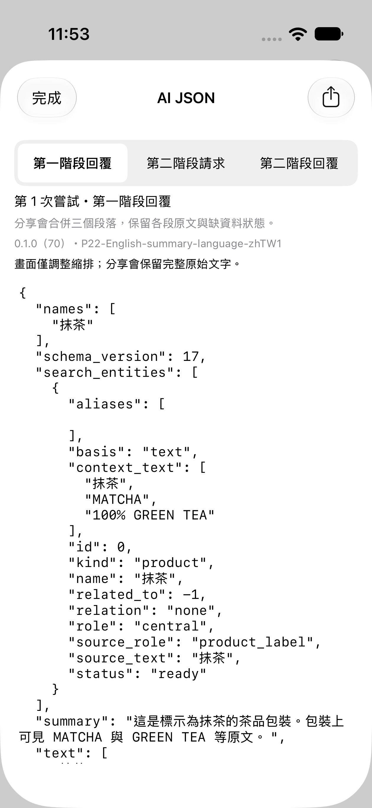
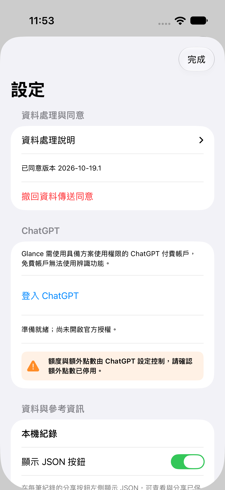

# Glance

用 iPhone 看懂眼前的物品與文字，把圖片、AI 簡介、原文和參考連結保存在同一張卡片。

Glance 是**免費、MIT 開源的個人視覺辨識試作**，不是 OpenAI 官方 App。App 本身不收費，但辨識需要**相容的 ChatGPT 付費方案，以及授予 Glance 使用 ChatGPT 方案的權限**。目前 Free 帳戶無法使用這條辨識路徑；持有付費方案也不代表一定能完成授權或呼叫服務。

目前尚未提供一般使用者可直接安裝的公開版本。Build 72 已完成隔離功能驗證，指定裝置簽署封裝與驗簽已完成；尚未完成本版實機驗收。原始碼可供自行建置，需使用自己的 Apple 簽署設定。

## 畫面導覽

以下是 Build 70 實際介面在 iOS 模擬器中的**示意截圖**。茶品圖片、辨識文字與百科來源資料皆為固定合成範例，未使用真實鏡頭、帳戶、模型或即時 Wikipedia 查詢。「鏡頭預覽區」標籤僅用於示意；正常使用時該區顯示相機預覽。

<table>
  <tr>
    <td align="center"> <strong>預覽與開始辨識</strong> 按下開始後，才取一張圖片辨識。</td>
    <td align="center"> <strong>保留圖片與原文來源</strong> 閱讀歷史時收合鏡頭，連結標明來源語言。</td>
  </tr>
  <tr>
    <td align="center"> <strong>查看 AI JSON</strong> 查看已保存的兩階段回覆與第二階段輸入。</td>
    <td align="center"> <strong>清楚說明使用條件</strong> 官方登入由本人操作，失敗時保留原帳戶。</td>
  </tr>
</table>

[查看原尺寸截圖與製作方式](docs/images/README.md)

## 可以做什麼

- **拍一張，再辨識一張。** 按「開始辨識」並停穩後送出一張圖片；下一張需要再次操作。也可從相簿選一張圖片辨識。
- **兩階段理解。** 第一階段取得名稱、簡介與可見原文，並辨識產品、品牌等語意實體；有合適百科候選時，第二階段用文字摘錄核對身分及關係。
- **保留原語言來源。** Wikipedia 依名稱選擇最多兩個原文語言站，並可補入同條目的中文語言連結；所有語言共用五個候選名額。匹配正確性優先於語言，沒有合適中文頁時保留原文來源；連結開啟實際採用的頁面。
- **中文簡介，原文如實保留。** 指令要求中文簡介，產品原名、OCR 與引用可保留原語言。App 如實顯示 AI 回覆，不另作語言攔截或翻譯；模型仍可能回外語或出錯。
- **分開顯示嘗試次數。** 卡片顯示整圖與第二階段各自的次數，第二階段另標示送出證據；嘗試不等於 AI 呼叫或計費次數。
- **回看、續做與重新辨識。** 圖片及結果保存在本機歷史。第二階段未完成時，帶驚嘆號的重試箭頭可只續做文字核對；處理中同位置顯示圓環，完成後點擊則重新辨識整張。長按選單也可選「重新辨識整張」，長按或關閉選單本身不送出請求。
- **清空後重新編號。** 清空全部歷史成功後，下一張從第 1 次開始；刪單筆不重排。
- **分享與查核。** 可分享圖卡、查看／複製已保存的 AI JSON。JSON 開關、第二階段回覆及輸入方便查核；較早紀錄未保存的資料不會補造。Google 搜尋連結由你點擊後才開啟；第二階段會優先提供同主體的通用中文搜尋名稱，無可靠中文名稱則保留原名。

## 帳戶、費用與服務限制

Glance 使用 Sign in with ChatGPT 的方案用量權限，透過 Responses API 呼叫服務；不要求你填入 API key，也不改用另一套 API key 計費。**App 免費與 ChatGPT 方案付費是兩件事。**

辨識會使用你授權的 ChatGPT 方案額度。有百科候選時，還可能送出一次文字核對請求。可用模型、帳戶權限、方案額度、服務限制與連線狀況都會影響結果；Glance 無法提供無限額度或保證每個付費帳戶都可用。請在 ChatGPT 設定確認額外點數已停用。

登入失敗會提示確認帳戶與產品使用要求；網路、取消、逾時、伺服器或憑證錯誤不會一律被斷言為免費帳戶。完成新帳戶授權及驗證前，原有可用帳戶會保留。

## 圖片與隱私

圖片與辨識指令會送往 OpenAI。公開名稱可能送至對應語言的 Wikipedia；候選摘錄與第一階段文字會用於第二階段核對。圖片中的人臉與文字不會自動遮蔽，請避免送出不希望外傳的內容。

Glance 在本機保存實際送出的 JPEG 副本與結果，不修改相簿原圖。刪除 App 內紀錄不會刪除相簿原圖，也不能收回已分享或已傳送的資料。完整流程見[資料處理與首次使用同意](docs/資料處理與首次使用同意.md)。

## 目前限制

AI 可能誤認物品、文字或品牌；百科連結與條碼不代表精確商品已獲驗證。候選不足或無法核對時，可能只保留第一階段結果。

低光、模糊或低紋理畫面可能辨識失敗。切出 App 或進入設定會關閉相機；連續預覽滿五分鐘或畫面持續全黑也會停止相機。已開始的兩階段辨識可在系統允許的有限背景時間內繼續，到期即停止，不保證背景完成。

本專案仍在試作階段；模擬器與合成測試不是實機相機、真實登入或模型品質保證。公開原始碼不等於已提供通用安裝包或已獲 App Store 核准。

## 文件與開發

- [使用流程](docs/取景與辨識流程.md)與[百科候選／兩階段](docs/使用與設計/百科候選與兩階段.md)
- [目前 AI 指令與 schema](docs/目前AI完整指令與Schema.md)
- [開發與建置](docs/開發指南.md)、[版本及驗證範圍](docs/現況與版本.md)
- [文件索引](docs/README.md) · [MIT 授權](LICENSE)
